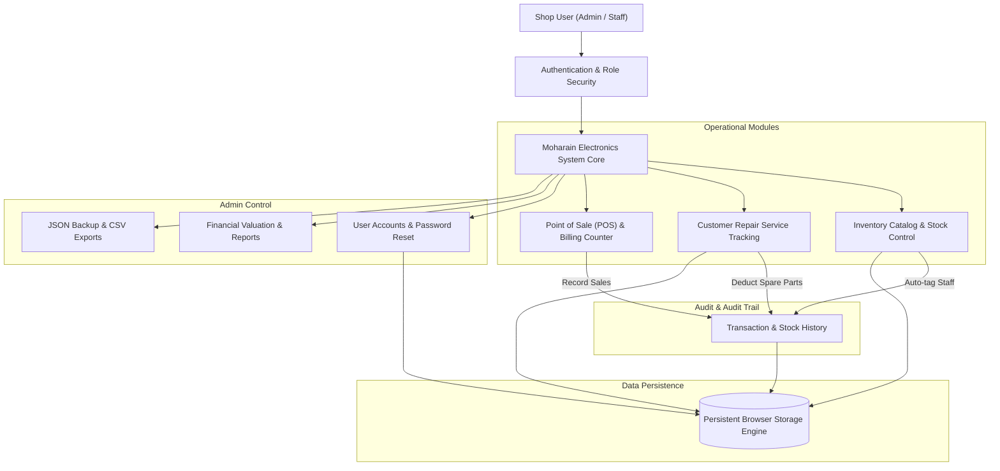
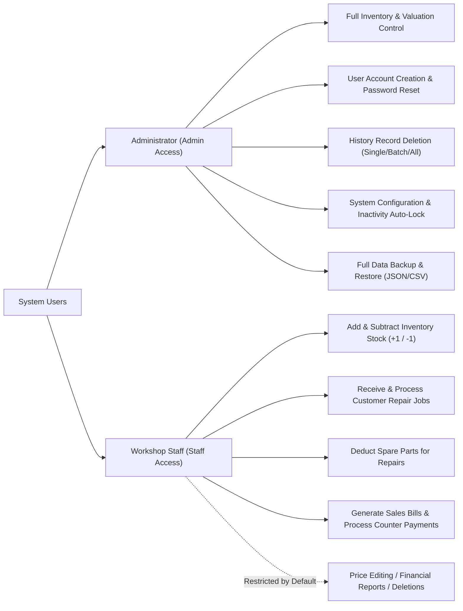
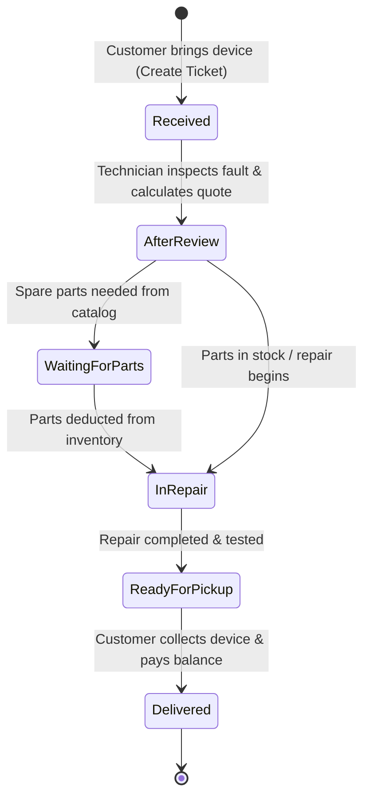
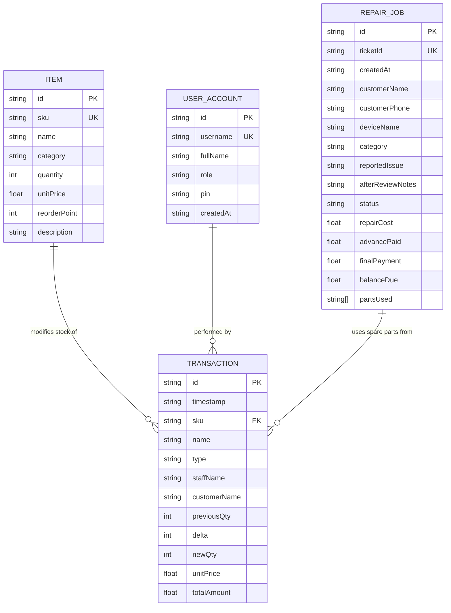
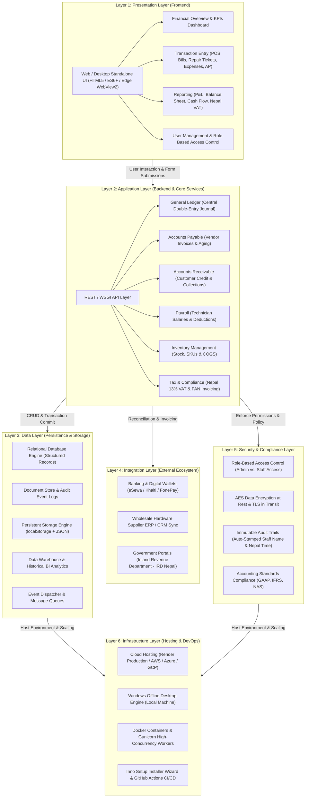
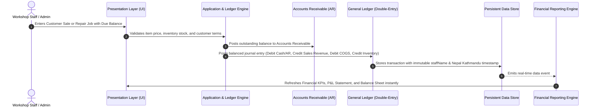

# Moharain Electronics Marmat Center &mdash; System Documentation

**Business Name:** Moharain Electronics Marmat Center  
**Location:** Dhangadhi, Hasanpur-5, Kailali, Nepal  
**Software Version:** 2.0.0 (Windows Desktop & Standalone Edition)  
**Time Standard:** Nepal Standard Time (Asia/Kathmandu, UTC+05:45)  
**Currency Unit:** Nepalese Rupee (Rs.)

---

## 1. Executive Summary

**Moharain Electronics Marmat Center** is an integrated desktop inventory control, customer repair job tracker, and point-of-sale billing system engineered specifically for electronics repair workshops and hardware retail operations. 

### Core Capabilities
- **Electronics Inventory Catalog:** Sequential auto-generated SKUs, stock valuation, automated reorder thresholds, low-stock warnings, and single/multi-item stock modifications.
- **Repair Service Ticketing:** End-to-end device servicing workflow from intake to diagnostics ("After Review"), spare parts deduction from stock, advance payments, and balance settlements.
- **Sales & Point of Sale (POS):** Fast multi-item billing counter with built-in workshop calculator, discount application, cash change return calculations, and stock deduction.
- **Role-Based Security & Multi-User Management:** Discrete **Admin Access** and **Staff Access** roles, individual user accounts, PIN/password resets, auto-lock on inactivity, and granular permission controls.
- **Automated Staff Audit Trail:** Every stock addition, deduction, spare part usage, and sale automatically records and logs the name of the staff member who performed the action.
- **100% Offline Standalone Architecture:** Runs completely offline without external server dependencies, installable on any Windows computer via an **Inno Setup Wizard (.EXE)** or portable launcher.

---

## 2. System Architecture & Workflows

### 2.1 High-Level Architectural Flowchart



---

### 2.2 User Role & Access Hierarchy



---

### 2.3 Repair Service Lifecycle State Diagram



---

### 2.4 Entity-Relationship Diagram (ERD)



---

## 3. Module Breakdown

### 3.1 Inventory Catalog Management
- **Sequential SKU Generator:** Generates standardized identifiers (e.g., `MEC-0001`, `MEC-0002`). SKU numbers can be automatically assigned or manually overridden.
- **Stock Confirmation Protection:** Every addition or subtraction of stock invokes a dedicated confirmation overlay preventing inadvertent quantity changes.
- **Multi-Item Bulk Editing:** Allows editing names, categories, selling prices, and quantities across multiple items simultaneously with change review confirmation.
- **Low Stock Threshold Alerts:** Items at or below their configured `reorderPoint` trigger visual amber alert badges and restock recommendations.

### 3.2 Customer Repair Management
- **Sequential Ticket Numbers:** Auto-formatted tracking tickets (e.g., `REP-20261013-0001`).
- **Diagnosis & "After Review" Quoting:** Separate fields for initial customer fault complaints and technician inspection findings.
- **Integrated Spare Parts Usage:** Technicians can select in-stock inventory items directly from a dropdown to attach them to a repair ticket, automatically reducing inventory.
- **Payment Lifecycle:** Tracks total quote, advance paid during intake, final payment on pickup, and automatically calculates remaining balance due.

### 3.3 Point of Sale (POS) & Quick Billing Counter
- **Multi-Line Customer Cart:** Build customer bills containing single or multiple hardware items.
- **Built-in Workshop Calculator:** Keypad on the billing overlay allows quick calculations (percentages, tax, discounts, sums) and 1-click value insertion into price, discount, or cash fields.
- **Real-Time Cash Change & Balance Due:** Calculates return change if cash given exceeds total, or due balance if partial payment is made.

### 3.4 Multi-User Management & Security (Admin Control)
- **User Creation:** Admin can create new staff or administrator accounts with custom usernames, display names, and minimum 4-character PINs/passwords.
- **Password Reset:** Admin can reset the password for any existing user at any time.
- **Access Safety Locks:** Prevents deleting the currently logged-in active user or the sole remaining administrator account.
- **Clean Sign-In Screen:** Login overlay without demo credentials or hardcoded hints.
- **Auto-Lock on Inactivity:** Automatically locks the screen after 5, 15, or 30 minutes of idle time.

### 3.5 Automated Staff Attribution
- Whenever an item's stock is increased, decreased, sold, or attached to a repair, the software queries `getActiveUser()`.
- The staff member's username is permanently stamped on the transaction record:
  - **Stored in Field:** `t.staffName`
  - **Displayed in UI:** Dedicated **`Staff / Changed By`** column in both the Reports tab and Admin History Management tab.
  - **Searchable:** History search inputs allow filtering records by staff name.

### 3.6 Default System Credentials & Password Management

The software initializes with two standard pre-configured role accounts:

| Account Type | Username | Default Password / PIN | Access Role | Permissions & Responsibilities |
| :--- | :--- | :--- | :--- | :--- |
| **Administrator** | `admin` | **`1234`** | `Admin Access` | **Full Administrative Privileges:** Full control over catalog pricing, total business valuation, reports, single/bulk history deletion, JSON data backups & restores, creating new user accounts, and resetting passwords for any staff or admin user. |
| **Workshop Staff** | `staff` | **`0000`** | `Staff Access` | **Daily Workshop Operations:** Adding and subtracting stock (+1 / -1), receiving repair devices, attaching spare parts to tickets, and processing counter billing sales. Restricted by default from viewing financial valuation reports, editing base item prices, or deleting history logs. |

> [!TIP]
> **Changing or Resetting Passwords:**  
> The Administrator can change any password or create dedicated individual accounts for each technician at any time by navigating to **Admin Access &rarr; Section 3: User Accounts & Password Management** &rarr; clicking **`Reset Password`** or **`+ Create New User`**.

---

## 4. Installation, Deployment & Updates

### 4.1 Distribution Package Structure
The standalone distribution package is located in `Moharain-Electronics-Install-Package/`:

```text
Moharain-Electronics-Install-Package/
│
├── Moharain-Electronics-Setup.exe           # Primary Inno Setup Windows Installer Wizard
├── Install-Moharain-Electronics-Software.bat # 1-Click fallback batch installer
├── Update-Software.bat                      # 1-Click update utility for existing PCs
├── Launch-Moharain-Electronics.bat          # Portable launcher (no installation needed)
├── index.html                               # Standalone software application file
├── icon.svg                                 # Software icon
├── manifest.json                            # Desktop PWA configuration
├── sw.js                                    # Offline caching service worker
└── HOW-TO-INSTALL.txt                       # Quick-start instructions
```

### 4.2 Installing on a New Computer
1. Copy `Moharain-Electronics-Setup.exe` to a USB flash drive.
2. Plug the USB into the target computer and double-click `Moharain-Electronics-Setup.exe`.
3. Accept the Windows UAC prompt (**Yes** to allow administrative install).
4. Follow the setup wizard. The software installs to `C:\Program Files (x86)\MoharainElectronicsCenter\` and creates Desktop and Start Menu shortcuts.

### 4.3 Pushing Updates to Other Computers
To update an existing installation without losing recorded inventory, repair jobs, or user logins:
- **Method A (1-Click Updater):** Copy `Update-Software.bat` and the updated `index.html` to a USB drive, plug into the target PC, and run `Update-Software.bat`.
- **Method B (Setup Wizard):** Run the new `Moharain-Electronics-Setup.exe` over the old installation.
- **Data Protection:** Browser persistent storage (`localStorage`) remains intact during updates.

---

## 5. Technical Specifications

| Parameter | Specification |
| :--- | :--- |
| **Target OS** | Microsoft Windows 10 / 11 (64-bit and 32-bit compatible) |
| **Runtime Environment** | Standalone Desktop Window (Microsoft Edge WebView2 / Chromium engine) |
| **Offline Capability** | 100% Offline (No internet or remote servers required) |
| **Data Storage Engine** | Persistent LocalStorage API with JSON serialization |
| **Backup Format** | Full JSON snapshot & RFC 4180 CSV spreadsheet export |
| **Installer Engine** | Inno Setup 6.7.3 (Lzma2 solid compression) |
| **Time Format** | ISO 8601 with Nepal Time Offset (`UTC+05:45`), Date stacked over Time |
| **Currency Rendering** | Nepalese Rupee (`Rs. #,##0.00`) |

---

## 6. Accounting Software Architecture & Financial Ledger

The software incorporates an enterprise-grade **6-Layer Accounting Architecture** engineered specifically for electronics retail and repair workshops, adhering to **Generally Accepted Accounting Principles (GAAP)**, **International Financial Reporting Standards (IFRS)**, and **Nepal Accounting Standards (NAS)**.

### 6.1 Enterprise 6-Layer Architectural Hierarchy



### 6.2 End-to-End Accounting Flow



### 6.3 Standard Chart of Accounts (COA) Structure

| Account Code | Account Head Name | Account Type | Normal Balance | Usage in Moharain Electronics |
| :--- | :--- | :--- | :--- | :--- |
| **`1010`** | **Cash on Hand** | Current Asset | **Debit** | Physical counter cash received from POS sales and customer repair settlements. |
| **`1020`** | **Bank / Digital Wallet** | Current Asset | **Debit** | Shop bank accounts and mobile wallet balances (eSewa, Khalti, FonePay QR). |
| **`1100`** | **Accounts Receivable (AR)** | Current Asset | **Debit** | Unpaid customer repair balances and credit hardware sales awaiting collection. |
| **`1200`** | **Inventory Asset** | Current Asset | **Debit** | Total cost value of shelf hardware, electronic components, and replacement spare parts. |
| **`2000`** | **Accounts Payable (AP)** | Current Liability | **Credit** | Unpaid vendor and supplier bills for wholesale parts purchases. |
| **`2100`** | **Customer Advances** | Current Liability | **Credit** | Upfront cash deposits paid by customers upon repair ticket intake before job completion. |
| **`3010`** | **Owner's Equity & Capital** | Equity | **Credit** | Initial shop investment capital and accumulated retained business earnings. |
| **`4010`** | **Retail Sales Revenue** | Operating Revenue | **Credit** | Gross income generated from counter hardware sales. |
| **`4020`** | **Repair Service Revenue** | Operating Revenue | **Credit** | Gross income generated from customer device repairs and servicing labor. |
| **`5010`** | **Cost of Goods Sold (COGS)** | Direct Expense | **Debit** | Wholesale purchase cost of sold components and spare parts consumed in repairs. |
| **`6010`** | **Shop Rent Expense** | Operating Expense | **Debit** | Monthly commercial premises rent for Hasanpur workshop. |
| **`6020`** | **Electricity & Utilities** | Operating Expense | **Debit** | Nepal Electricity Authority (NEA) commercial meter bills and workshop water. |
| **`6030`** | **Technician Salaries & Wages**| Operating Expense | **Debit** | Monthly staff salaries, overtime allowances, and technician wages. |
| **`6040`** | **Workshop Tools & Supplies** | Operating Expense | **Debit** | Soldering wire, flux, tester probes, heat shrink, and workshop consumables. |
| **`6050`** | **Transport & Fuel** | Operating Expense | **Debit** | Component pickup transport, courier fees, and delivery vehicle fuel. |
| **`6090`** | **Miscellaneous Expenses** | Operating Expense | **Debit** | Tea, client refreshments, cleaning supplies, and minor shop maintenance. |

---

### 6.4 Complete Financial Statements Suite

1. **Statement of Profit & Loss (Income Statement):**
   - **Gross Turnover:** Retail Sales Revenue + Repair Service Revenue
   - **Cost of Goods Sold (COGS):** Wholesale cost of sold items and parts
   - **Gross Operating Profit:** $\text{Turnover} - \text{COGS}$ ($\text{Gross Margin} = \frac{\text{Gross Profit}}{\text{Turnover}} \times 100$)
   - **Operating Expenses:** Rent, Utilities, Wages, Tools, Transport, Misc
   - **Net Operating Profit / (Loss):** $\text{Gross Profit} - \text{Operating Expenses}$

2. **Balance Sheet (Statement of Financial Position):**
   - **Current Assets:** Cash on Hand + Bank / Mobile Wallets + Accounts Receivable + Inventory Stock Valuation
   - **Current Liabilities:** Accounts Payable (Vendor Bills) + Customer Advance Deposits
   - **Owner's Equity:** Retained Earnings & Working Capital
   - **Fundamental Balance Equation:**
     $$\\mathbf{\text{Assets} = \text{Liabilities} + \text{Equity}}$$

3. **Statement of Cash Flows:**
   - **Cash Inflows:** Cash POS counter sales, repair settlements, AR customer collections.
   - **Cash Outflows:** Supplier payments, shop rent, NEA electricity bills, staff payroll, tool purchases.
   - **Net Operating Cash Flow:** $\text{Cash Inflows} - \text{Cash Outflows}$.

4. **Nepal Tax & Compliance (VAT 13% & PAN Invoicing):**
   - Output VAT calculated at standard **13%** on taxable retail turnover.
   - Input VAT credit on wholesale parts invoices.
   - Net VAT payable to Government of Nepal Inland Revenue Department (IRD).
   - Official PAN billing header (PAN: `601928374`).
